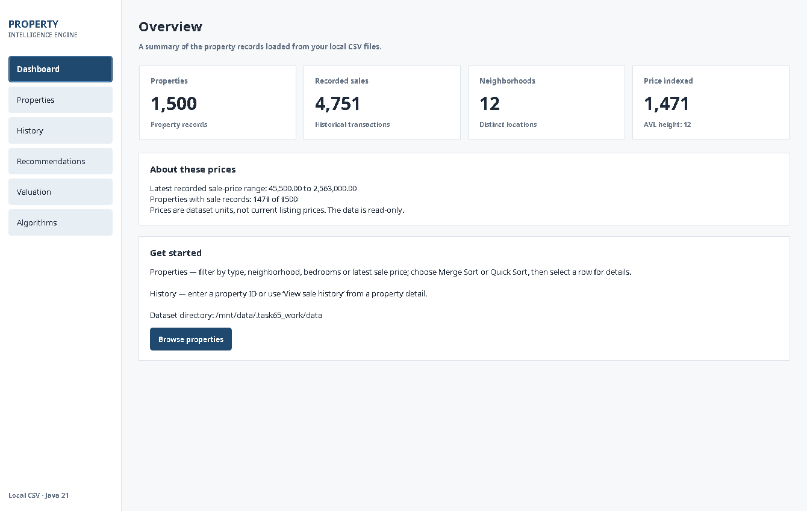
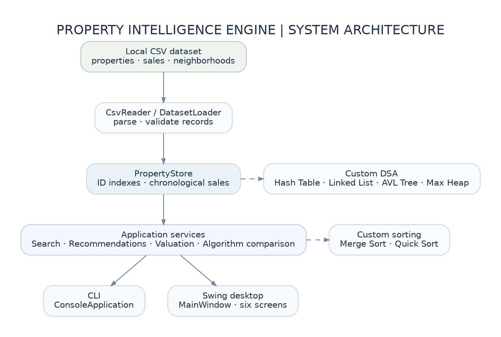

# Property Intelligence Engine

**Java 21 · Data Structures and Algorithms · Swing + CLI · Local CSV**

Property Intelligence Engine is a desktop application for exploring a synthetic property dataset through **custom-built data structures and algorithms**. It supports property lookup, filtering and sorting, chronological sale history, preference-based recommendations, comparable-sale valuation, and an educational comparison of algorithm performance.

The system is entirely local. It does **not** use a database, web API, machine learning, or live real-estate listings. Both the desktop interface and the CLI use the same application services.



## Features

| Area | Capabilities |
|---|---|
| Dashboard | Property, neighborhood and sale counts; AVL index coverage and latest-sale price range |
| Properties | Exact-ID lookup, type/location/bedroom/price filters, Merge Sort or Quick Sort, property details |
| Sale history | Chronological transactions and absolute/percentage changes |
| Recommendations | Up to five budget-eligible properties ranked by a transparent preference score using a custom Max Heap |
| Valuation | Average of up to five recent, same-type comparable sales, selected using similarity ranking |
| Algorithms | Hash Table vs linear scan, AVL range search vs linear scan, Merge Sort vs Quick Sort |

## Requirements

- **Java Development Kit 21** (not just a Java runtime)
- **Apache Maven 3.9+**
- A desktop environment for Swing (the CLI runs without one)

No third-party runtime libraries are required. JUnit 5 is used for tests.

## Getting started

Run commands from the repository root (the folder containing `pom.xml` and `data/`).

```bash
mvn clean test
mvn -Pdesktop exec:java    # Swing desktop application
```

For the command-line interface:

```bash
mvn exec:java
```

The project reads `data/neighborhoods.csv`, `data/properties.csv`, and `data/sales.csv` at startup. To use a different dataset directory after compiling:

```bash
java -cp target/classes edu.shu.propertyintel.Main /path/to/data
java -cp target/classes edu.shu.propertyintel.DesktopMain /path/to/data
```

For step-by-step usage and example interactions, see the [user guide](docs/USER_GUIDE.md).

## Dataset

| Dataset | Records |
|---|---:|
| Properties | **1,500** |
| Recorded sales | **4,751** |
| Neighborhoods | **12** |
| Properties with at least one sale | **1,471** |
| Properties without recorded sales | **29** |

The synthetic transactions span 2011–2026; the latest recorded sale is **2026-10-27**. IDs and relationships are checked during loading. The dataset can be regenerated using `python3 tools/generate_dataset.py`. Details and field definitions are in [DATASET_NOTES.md](DATASET_NOTES.md).

**All property details and prices are fictional.** Prices are unspecified dataset units, **not** PKR, USD, current asking prices, or a verified market valuation.

## DSA implementation

| Implementation | Real application role |
|---|---|
| `CustomHashTable` | Fast property/neighborhood lookups, sale-history mapping; collisions resolved by separate chaining |
| `CustomLinkedList` | Chronologically sorted property sales, property iteration, hash buckets and equal-price AVL values |
| `AVLTree` | Balanced index on the **latest recorded sale price** with inclusive range queries |
| `MergeSort` / `QuickSort` | User-selected ordering of property search results |
| `MaxHeap` | Top-five recommendations and similarity-ranked comparable selection |

The core structures and sorting algorithms are implemented in `src/main/java/edu/shu/propertyintel/`. Java standard-library collections are used where appropriate for ordinary application plumbing, not to replace the assessed DSA implementations.



## Project layout

```text
src/main/java/edu/shu/propertyintel/
  model/       Property, Sale, Neighborhood
  data/        CsvReader, DatasetLoader, PropertyStore
  dsa/         CustomLinkedList, CustomHashTable, AVLTree, MaxHeap
  algorithm/   MergeSort, QuickSort
  service/     Search, recommendation, valuation, comparison
  cli/         ConsoleApplication
  ui/          Swing screens, table models, validation, theme
  Main.java         CLI entry point
  DesktopMain.java  Desktop entry point
src/test/java/edu/shu/propertyintel/    JUnit tests
data/                                 Committed synthetic CSVs
tools/                                Deterministic dataset generator
docs/                                 Technical guides, diagrams, screenshots
```

## Engineering and verification

The test suite contains **96 JUnit test methods**, covering data parsing/integrity, custom DSA behavior, algorithm correctness, services, CLI scenarios, and GUI interactions. The committed expanded dataset is used by integration tests. Run `mvn clean test` to check the current revision; see the [testing and verification guide](docs/TESTING.md).

The algorithm comparison screen reports **measured** median timings on the current machine, after warm-up and with result-equivalence checks. These readings are educational—not controlled JMH microbenchmarks or guaranteed speedups.

## Technical documentation

- [Architecture and data flow](docs/ARCHITECTURE.md) — packages, loading, indexes and UI/service separation.
- [Algorithms and complexity](docs/ALGORITHMS.md) — implementation decisions, pseudocode, scoring, valuation and Big-O.
- [User guide and screenshots](docs/USER_GUIDE.md) — six desktop screens, CLI navigation and troubleshooting.
- [Testing and verification](docs/TESTING.md) — coverage matrix, reproducible commands and known constraints.
- [Dataset notes](DATASET_NOTES.md) — schema, synthetic generation and recency policy.

The editable diagram sources (`.dot`) and their rendered PNGs are in `docs/diagrams/`.

## Boundaries

Data is read-only and synthetic. Recommendations are deterministic preference rankings, **not predictions**. Valuation is an **unadjusted mean of recent comparable sale prices** and is not a professional appraisal. The GUI targets desktop sizes; the project is not a deployed service or mobile application.

