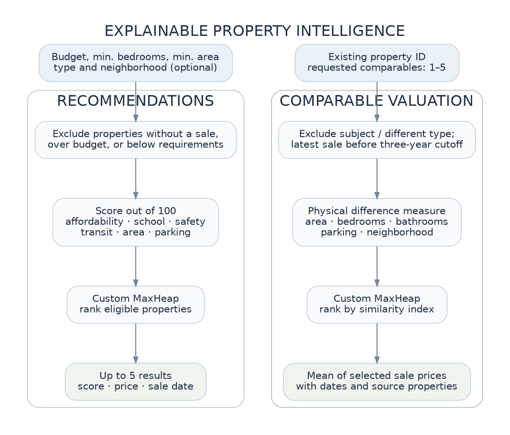

# Algorithms and complexity

This guide describes the algorithms **as implemented in this repository**. The main source files are under `src/main/java/edu/shu/propertyintel/{dsa,algorithm,service}`. All measured performance depends on the runtime and dataset; the Big-O bounds describe asymptotic behavior rather than a guaranteed elapsed time.

## Notation

| Symbol | Meaning |
|---|---|
| `n` | Total properties in memory |
| `u` | Distinct latest-sale price keys in the AVL index (`u ≤ n`) |
| `h` | Sales belonging to one property |
| `k` | Properties returned by an indexed price range |
| `r` | Properties retained after filtering, before sorting |
| `m` | Eligible candidates added to a heap (`m ≤ n`) |
| `c` | Comparable properties returned (`1–5` in the desktop UI) |

## 1. Custom singly linked list

**Source:** `dsa/CustomLinkedList.java`

Each node holds a value and a reference to its successor. The list tracks its `head`, `tail`, and `size`.

- `addLast(value)` attaches a new node using the tail reference, without traversing the list: **O(1)**.
- `insertSorted(value, comparator)` walks to the first successor whose value sorts after the new one and inserts before it: **O(h)** for a sale history of length `h`.
- `getLast()` reads the tail: **O(1)**. `iterator()` walks nodes in order: **O(h)** for the entire history.

`PropertyStore.addSale()` uses `insertSorted()` with a comparator of **sale date, then sale ID**, so the file can contain unordered transactions while the history remains chronological. The latest recorded sale is `getLast()`. Linked lists also implement Hash Table chains and store multiple properties sharing an AVL price key.

**Trade-off:** efficient tail insertion and sequential access, but no random access or binary search; sorted insertion may visit the full list.

## 2. Custom Hash Table — separate chaining

**Source:** `dsa/CustomHashTable.java`

`CustomHashTable<K,V>` allocates an array of linked-list buckets. Keys use:

```java
int index = (key.hashCode() & 0x7fffffff) % buckets.length;
```

A collision means two distinct keys map to the same bucket, **not** that one entry should overwrite another. The implementation traverses the bucket and compares keys with `equals()`; an existing key is updated, and a new key is appended to the bucket list.

Initial capacity is **16**. Before a new insertion would push the load factor above **0.75**, the array size is doubled and all entries are rehashed. This helps keep chains short under typical key distributions. Resizing costs **O(n)** in that operation, but insertion is **O(1) amortized on average**.

**Applications:** `PropertyStore` indexes properties, neighborhoods, sale histories and sale IDs. A missing property-ID lookup returns `null` so the presentation layer can show a useful error message.

**Complexity:** average lookup/insertion **O(1)**, collision-heavy worst case **O(n)**; storage **O(n + b)** for entries plus `b` buckets. The current implementation does not provide key deletion, because records are loaded once and are read-only.

## 3. AVL Tree — latest-sale price index

**Source:** `dsa/AVLTree.java`; built and queried by `service/PropertySearchService.java`.

Each AVL node holds a **price key**, an ordered linked list of **all properties** at that exact price, its children and cached node height. As records are inserted, the algorithm updates heights and calculates:

\[
\text{balance factor} = \text{height(left)} - \text{height(right)}
\]

A valid AVL node has a balance factor of `−1`, `0`, or `+1`. The implementation handles four imbalance patterns: left-left (`rotateRight`), right-right (`rotateLeft`), left-right (left rotation on child, then right), and right-left (right rotation on child, then left). Each rotation changes a constant number of links and updates two node heights.

**Why duplicate keys matter:** the synthetic dataset intentionally repeats sale prices. Adding a second property with the same price appends it to that node's linked list instead of discarding it or inventing a price offset. Thus `size()` counts indexed **properties**, while `distinctKeys()` counts price nodes.

**Inclusive range search** uses the BST ordering to prune impossible branches:

```text
range(node, minimum, maximum)
    if node is null: return
    if minimum < node.key: visit left subtree
    if minimum <= node.key <= maximum: emit all values at this node
    if maximum > node.key: visit right subtree
```

Searching a key takes **O(log u + d)** when returning `d` properties at that key; an inclusive range query takes **O(log u + k)** in the standard output-sensitive model. Building the index by inserting all sold properties takes **O(n log u)** in aggregate (upper bound **O(n log n)**). AVL nodes and associated lists use **O(n)** memory.

Price bounds always refer to the property's **latest dated sale**. Unsold properties are not present in the AVL index, but remain browsable through unbounded searches.

## 4. Merge Sort and Quick Sort

**Sources:** `algorithm/MergeSort.java`, `algorithm/QuickSort.java`.

The search service puts filtered properties into a Java array, then invokes the selected **custom** sort with a `Comparator<Property>`. Built-in `Collections.sort` / `Arrays.sort` are not used to order these results. The comparison key may be latest sale price, area, bedrooms or year built; property ID resolves equal-key ties deterministically.

### Merge Sort

The array is divided recursively into halves until ranges contain at most one element. The merge step compares the front of each half and writes the smaller element into a reusable cloned buffer, then copies the merged segment back. With equal comparator keys, it takes the left item first (`<= 0`), preserving input order.

- Time: **O(r log r)** in best, average and worst cases.
- Auxiliary storage: **O(r)** for the buffer, plus **O(log r)** recursion stack.
- Stable: **yes**.

### Quick Sort

The implementation chooses a **median-of-three** pivot and applies a three-way (less / equal / greater) partition, which avoids excessive partition work on repeated values. It recursively sorts the smaller partition and loops over the larger partition, limiting recursion depth.

- Time: **O(r log r)** average; **O(r²)** worst case, since pivot choice does not guarantee balanced partitions.
- Extra stack: **O(log r)** due to recursing on the smaller partition; in-place partitioning uses constant additional array storage.
- Stable: **no**.

**Why both?** They demonstrate divide-and-conquer trade-offs: Merge Sort guarantees its time bound and stability; Quick Sort performs in-place partitioning but retains a quadratic worst case.

## 5. Custom binary Max Heap

**Source:** `dsa/MaxHeap.java`.

The complete binary tree is represented in a growable `Object[]`, with positions derived from array indexes:

```text
parent(i) = (i - 1) / 2
left(i)   = 2*i + 1
right(i)  = 2*i + 2
```

The comparator defines what "highest priority" means. `add()` places the new item at the end and repeatedly **sifts up** while it outranks its parent; `poll()` removes the root, moves the last item to the root and **sifts down** against the higher-priority child. `peek()` reads the root without removing it.

- `peek`: **O(1)**.
- `add` and `poll`: **O(log m)**, with occasional **O(m)** array resizing during insertion.
- Storage: **O(m)** for `m` items; the array doubles when needed.

The same generic heap supports two applications using different comparators: preference-ranked recommendations and similarity-ranked comparable sales.

## 6. Recommendation scoring and selection

**Sources:** `service/RecommendationCriteria.java`, `service/RecommendationService.java`.

Eligibility is evaluated **before** ranking. A candidate must have a recorded latest sale, cost no more than the user's budget, meet minimum bedrooms/area, and match optional type/neighborhood restrictions. Candidates are scored out of **100**, with higher scores better:

| Component | Maximum points | Implemented calculation |
|---|---:|---|
| Affordability | 25 | `25 × (budget − latestPrice) / budget` |
| School quality | 20 | `20 × clamp(schoolScore,0,10) / 10` |
| Safety | 20 | `20 × clamp(safetyScore,0,10) / 10` |
| Transit | 10 | `10 × clamp(transitScore,0,10) / 10` |
| Area | 15 | `15 × clamp(area / max(150, 1.5 × minimumArea),0,1)` |
| Parking | 10 | `10 × clamp(parkingSpaces / 2,0,1)` |

Every eligible property is inserted into a Max Heap by score; tied scores are ordered deterministically by property ID. The UI extracts at most **five** recommendations. The dates shown are **recorded transaction dates**; recommendations are *not* claims that the properties are currently listed for sale.

With `m` eligible properties, scanning costs **O(n)**, repeated heap insertions **O(m log m)**, and extracting five items **O(5 log m)**: overall upper bound **O(n log n)**. The score is a **hand-designed preference measure**, not an ML prediction or probability of buyer satisfaction.

## 7. Comparable-property valuation

**Sources:** `service/ComparableValuationService.java`, `service/ComparableProperty.java`, `service/ValuationResult.java`.

Valuation requires a valid subject property ID. It determines the latest sale date anywhere in the **loaded dataset**, then subtracts three years to obtain an **inclusive recency cutoff**. For the committed dataset, the newest sale is **2026-10-27** and the cutoff is **2023-10-27**. Each candidate must be a **different property of the same type**, with a latest sale **on or after** the cutoff.

The code computes a physical-feature difference score:

\[
\begin{aligned}
D ={}& 4|beds_s-beds_c| \\
&+6\frac{|area_s-area_c|}{\max(area_s,1)} \\
&+0.75|baths_s-baths_c| \\
&+0.5|parking_s-parking_c| \\
&+1.5\,\mathbf{1}[neighborhood_s\ne neighborhood_c]
\end{aligned}
\]

It converts distance to a **relative similarity index** `S = 1 / (1 + D)` and selects the top `c` eligible comparables using the same Max Heap (the GUI allows `c = 1…5`). The estimated price is the **ordinary arithmetic mean** of their latest recorded sale prices:

\[
\text{estimate} = \frac{\sum_{i=1}^{c} \text{salePrice}_i}{c}
\]

No inflation, time, location or market-index adjustment is applied to the prices. If fewer eligible comparables exist, the code uses only those found; if none exist, it returns **no estimate**, instead of producing a number without supporting sales. The subject's own sale is not included among its comparables.

The date scan is **O(n)**; ranking at most `m` eligible candidates is **O(m log m)**; extracting `c` is **O(c log m)**. Memory is **O(m)**. The match index is **not** an accuracy probability, and the estimate is **not an appraisal**.



## 8. Algorithm comparison methodology

**Source:** `service/AlgorithmComparisonService.java`.

The benchmark screen compares **equivalent outcomes before timing**:

1. Property-ID lookups through `CustomHashTable` and a linear property scan.
2. Latest-sale price-range results through the AVL index and a linear scan of properties.
3. Area sorting through Merge Sort and Quick Sort, each on a fresh clone of the same input array with the same comparator.

Each comparison performs **two warm-up trials and five measured trials** and reports a **median microseconds-per-operation** figure. For sorting, the input copy is excluded from the timed operation. The GUI runs the comparison in a `SwingWorker` to keep the window responsive.

The results are useful for observing behavior, not proving theoretical complexity from a single run. JVM JIT compilation, garbage collection, data distribution, the desktop environment and timing resolution can change results between runs. For rigorous Java microbenchmarking, a framework such as JMH would be appropriate but is outside this project's scope.

## Complexity summary

| Operation | Time | Additional space / caveat |
|---|---|---|
| Linked-list append / latest history sale | O(1) | O(1) per operation |
| Chronological insertion into one history | O(h) | O(1) beyond new node |
| Hash-table lookup/put | O(1) average, O(n) worst | O(n + buckets) overall; resize spikes |
| AVL key lookup | O(log u + returned values) | O(n) index overall |
| AVL inclusive range | O(log u + k) | O(k) returned list |
| Search filters without price bounds | O(n) before sorting | O(r) result array/list |
| Merge Sort of results | O(r log r) | O(r) buffer |
| Quick Sort of results | O(r log r) average, O(r²) worst | O(log r) recursion stack |
| Max Heap add / extract | O(log m), amortized | O(m) heap overall |
| Top-five recommendations | O(n + m log m + 5 log m) | O(m) |
| Valuation from `c` comparables | O(n + m log m + c log m) | O(m) |

These bounds include the core computations, not the time to start the JVM, load CSV files, or render the Swing UI.
