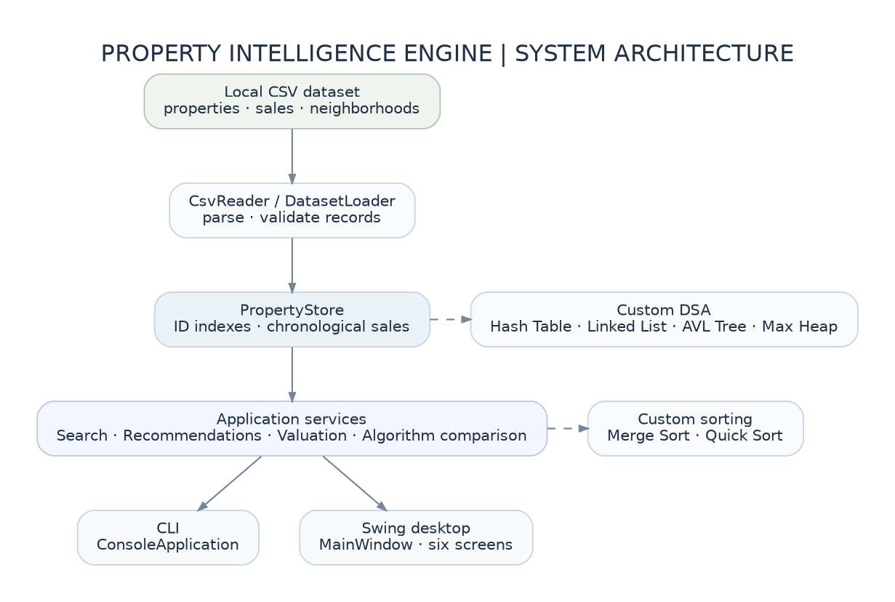
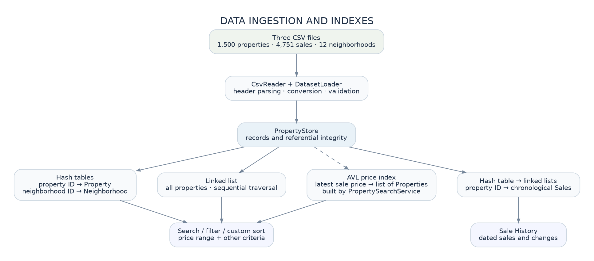
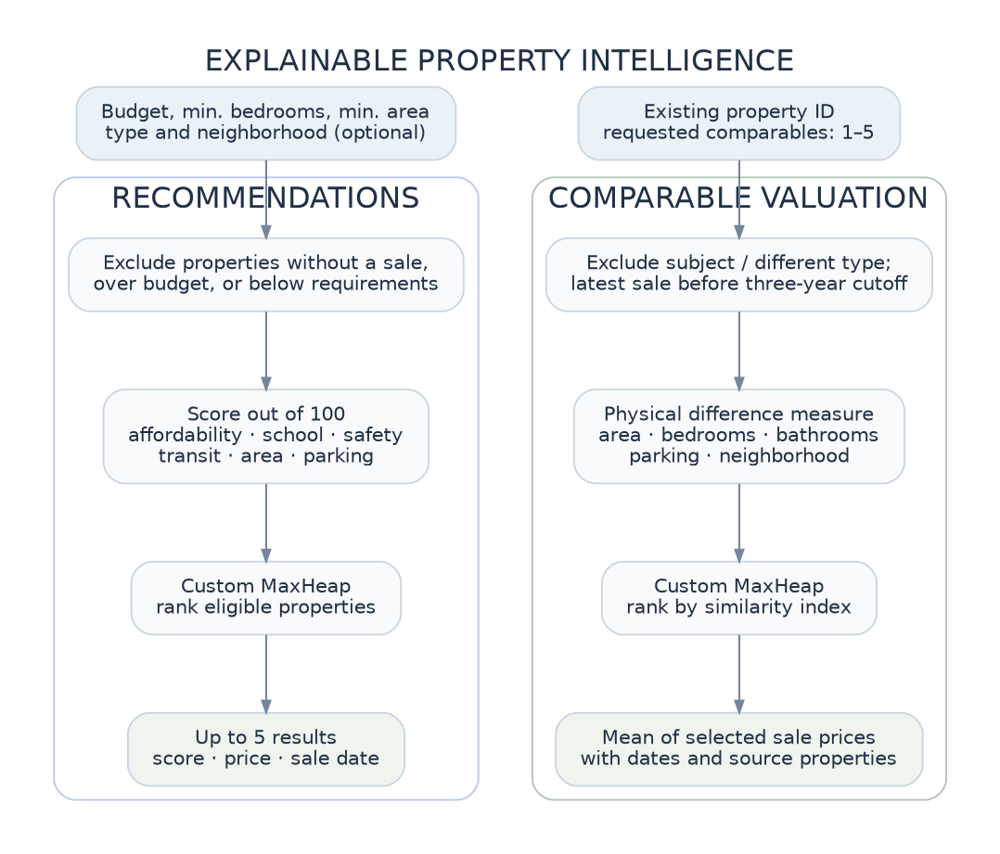

# Architecture and data flow

## System boundary

Property Intelligence Engine runs entirely in a local Java 21 process. It reads three UTF-8 CSV files once during startup, builds an in-memory repository and search index, and exposes the same application services through two front ends: an interactive CLI and a six-screen Swing desktop UI. There is no network access or persistent write path in the application.

### Package responsibilities

| Package / entry point | Responsibility | Important classes |
|---|---|---|
| `Main` | Load data; launch CLI | `Main.java` |
| `DesktopMain` | Load data; start Swing on the Event Dispatch Thread | `DesktopMain.java` |
| `model` | Immutable domain records | `Property`, `Sale`, `Neighborhood` |
| `data` | CSV decoding and ID/referential validation; repository | `CsvReader`, `DatasetLoader`, `PropertyStore` |
| `dsa` | Assessed custom structures | `CustomLinkedList`, `CustomHashTable`, `AVLTree`, `MaxHeap` |
| `algorithm` | Assessed custom sort methods | `MergeSort`, `QuickSort` |
| `service` | Reusable application operations | `PropertySearchService`, `RecommendationService`, `ComparableValuationService`, `AlgorithmComparisonService` |
| `cli` | Text input and formatted output | `ConsoleApplication` |
| `ui` | Swing screens and table adapters, input constraints, visual consistency | `MainWindow`, panels, `*TableModel`, `InputRules`, `UiTheme` |

The `ui` and `cli` packages use services and `PropertyStore`; they do not implement their own sorting, hashing or similarity rankings.

## Data ingestion

**Load order matters:** `DatasetLoader` loads neighborhoods first, properties second, and sales last. This permits `PropertyStore` to reject a property that references an unknown neighborhood or a sale that references an unknown property. Duplicate property, neighborhood and sale IDs are rejected.

`CsvReader` handles quoted fields, escaped quotes, UTF-8, and embedded newlines, then checks that record widths match the header. Numeric and date conversion is performed in `DatasetLoader`; domain validation is applied in `PropertyStore`. The loader fails visibly on invalid inputs rather than silently skipping them.

### In-memory layout

| Data need | Representation | Reason |
|---|---|---|
| Property by ID | `CustomHashTable<String, Property>` | Average constant-time lookup |
| Neighborhood by ID | `CustomHashTable<String, Neighborhood>` | Resolve neighborhood details while filtering/displaying |
| Sale history by property ID | `CustomHashTable<String, CustomLinkedList<Sale>>` | Fast history lookup with chronological traversal |
| Distinct sale IDs | `CustomHashTable<String, Boolean>` | Duplicate detection |
| All property records | `CustomLinkedList<Property>` | Deterministic iteration over loaded records |
| Latest-sale price index | `AVLTree<Double, Property>` in `PropertySearchService` | Balanced range queries, including repeated prices |

A property's latest sale is obtained from the **tail** of its date-sorted sale list. `PropertySearchService` then inserts that price and property into the AVL index at construction. Properties without recorded sales are present in the repository but not in this price index.

`PropertyStore` and `PropertySearchService` are built for a **read-only loaded dataset**. They are not an incremental editable database; reloading different CSVs requires restarting the application.

## Operation flows

### Search

1. The user supplies optional type, neighborhood, minimum-bedroom and latest-sale-price constraints.
2. If either price bound is present, `PropertySearchService` asks the AVL index for the inclusive range; otherwise it iterates all properties.
3. It applies the remaining filters to the candidates.
4. It copies matching properties into an array and sorts it using the chosen custom Merge Sort or Quick Sort.
5. The CLI prints rows; the Swing `PropertyTableModel` exposes the same order through `JTable` (Swing auto-sorting is disabled).

The price query is based on a property's **latest recorded transaction**, not a current listing or appraised value.

### Sale history

`PropertyStore.salesFor(id)` returns chronological sales. The CLI or `SaleHistoryTableModel` walks the list, displaying the dated transaction price and its change relative to the preceding sale. For a first sale there is no preceding change; for a property with no sales, the UI displays an empty-state explanation.

### Recommendations and valuation

Both services scan candidates from the read-only repository, apply eligibility checks, and use the custom `MaxHeap` for ranking. Their ranking semantics differ: Recommendations optimizes a preference score under a budget; Valuation seeks physical similarity to a subject property among recent same-type sales. See [Algorithms and complexity](ALGORITHMS.md).

### Algorithm comparison

`AlgorithmComparisonService` runs paired operations with equivalent inputs, confirms that outputs agree, performs warm-up trials and records median microsecond timings. On Swing, `ComparisonPanel` runs the service using `SwingWorker`, keeping the event-dispatch thread available to redraw and respond to interactions.

## UI design and operational constraints

`MainWindow` holds Dashboard, Properties, History, Recommendations, Valuation and Algorithms in a `CardLayout`, with a persistent sidebar. Each panel owns only view state and invokes a service for computations. `InputRules` constrains prices and IDs; spinners and dropdowns constrain bedrooms, comparable count, property types and neighborhoods. Tables are read-only, and scrollbars are used instead of hiding content at narrow desktop sizes.

`UiTheme` uses explicit primary/secondary button foreground and background styling, avoiding low-contrast macOS native-button overrides. The application supports windows around **1000 × 650 px** and larger; behavior below that size or on mobile screens is not a stated goal.

## Data model

| CSV | Primary ID | Key relationship | Core attributes |
|---|---|---|---|
| `properties.csv` | `property_id` | `neighborhood_id` → neighborhoods | type, beds, baths, area, year, parking, floor, furnished, amenities, description |
| `sales.csv` | `sale_id` | `property_id` → properties | `sale_date`, `sale_price` |
| `neighborhoods.csv` | `neighborhood_id` | referenced by properties | name, distance to center, school, transit, safety scores |

Fields and the deterministic generation method are documented in [DATASET_NOTES.md](../DATASET_NOTES.md). The dataset includes intentional **missing sales** (29 properties) and repeated prices, exercising empty-history and AVL duplicate-key behavior.

## Scope decisions

- **Why CSV instead of a database?** Local reproducibility and direct visibility of the core in-memory DSA implementation.
- **Why two interfaces?** The CLI demonstrates testable functionality independently of Swing; Swing makes the same engine approachable for demonstrations.
- **Why no ML?** Recommendations and valuations are deterministic, explicitly explainable algorithms within a DSA course's scope.
- **Why no editing or dynamic index updates?** The repository is intentionally load-once/read-only; consistent multi-index mutation and persistence are out of scope.
