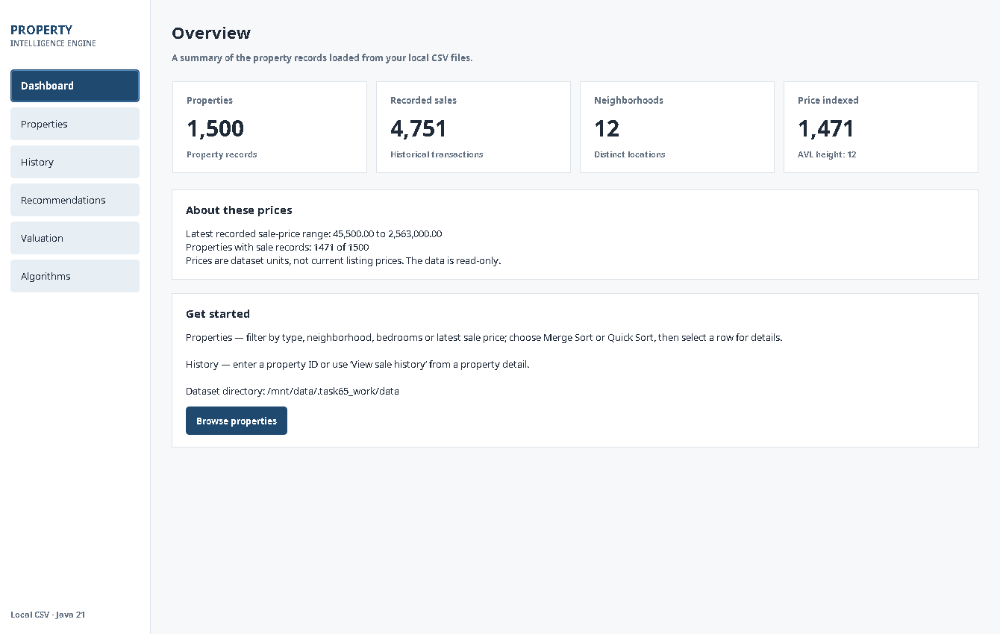
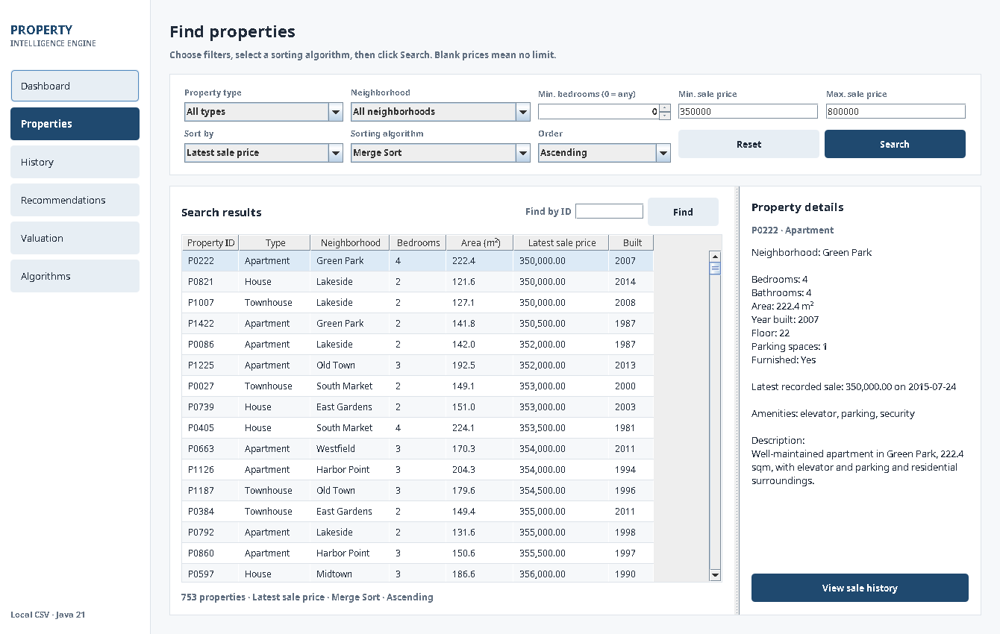
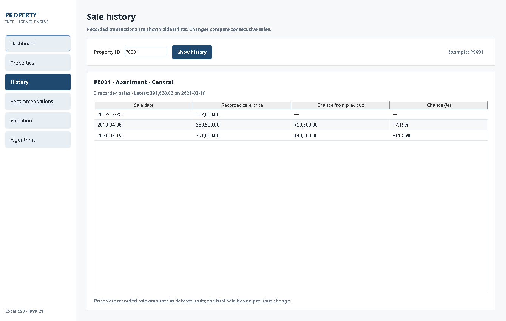
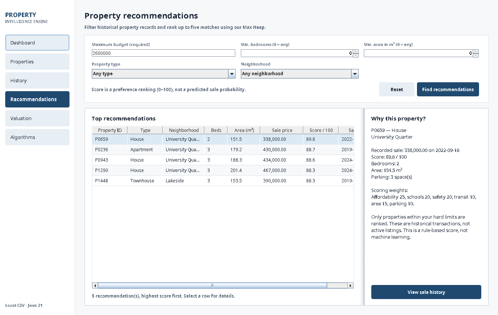
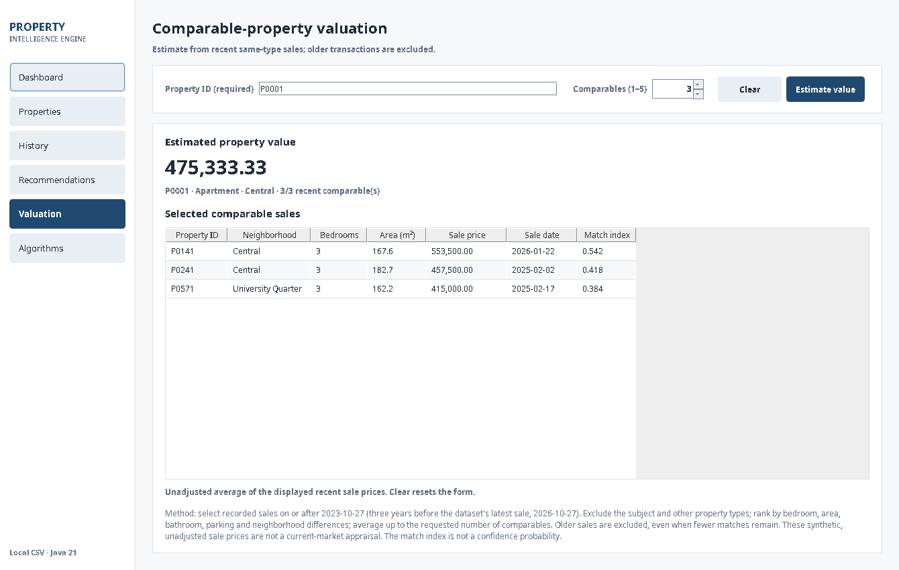
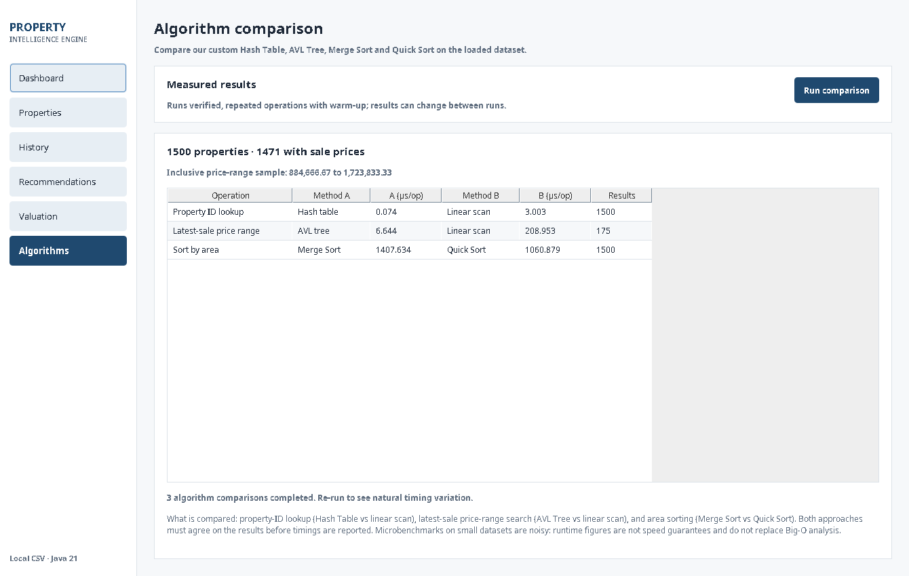

# User guide

The desktop application and CLI provide the same core features. This guide uses the **committed 1,500-property synthetic dataset**. All prices refer to **historical recorded transactions in unspecified synthetic units**, not active listings or market quotations.

## Start the application

From the folder containing `pom.xml`:

```bash
mvn clean test
mvn -Pdesktop exec:java
```

For a terminal-only version, run `mvn exec:java` instead. The desktop window has a persistent sidebar; use it to move between Dashboard, Properties, History, Recommendations, Valuation and Algorithms. No login, connection or database setup is needed.

## 1 — Dashboard



The Dashboard confirms the loaded dataset and index coverage. For the submitted files it shows **1,500 properties**, **4,751 recorded sales**, **12 neighborhoods**, and **1,471 properties in the latest-sale-price AVL index**. The displayed price range describes recorded sales, not estimates. Select **Browse properties** or **Properties** to explore records.

## 2 — Properties: search, filter and inspect



1. Choose a **property type** and/or **neighborhood** from the dropdowns. Leave them on *All* to avoid filtering those fields.
2. Choose a minimum bedroom count; **0** includes all.
3. Enter an optional minimum and/or maximum **latest recorded sale price**. Both bounds are inclusive. Blank fields mean no price limit.
4. Choose the sorting field (price, area, bedrooms or year built), the algorithm (**Merge Sort** or **Quick Sort**) and ascending or descending order.
5. Select **Search**. The count and table update. Select a row to read its details and use **View sale history** to open its transaction record.

The screenshot uses a minimum price of **350,000** and a maximum price of **800,000**, with 753 matches in the committed dataset. Results are ordered by the application's custom sorter, not the built-in `JTable` sorter.

**Quick lookup:** The **Find by ID** field ignores other filters and uses the custom hash table. Try `P0001`, `P0500`, or `P1500`. **Reset** restores the filters.

**No matches?** Clear restrictive filters or increase the price range. Properties without sales can appear in searches with no price bounds, but cannot match a latest-sale-price constraint.

## 3 — History: dated transactions



Enter an existing property ID, for example `P0001`, then select **Show history**. Sales appear **oldest first**, followed by the absolute and percentage change from the preceding transaction.

The calculation for each adjacent pair is:

```text
change = current sale price - previous sale price
percentage change = change / previous sale price × 100
```

The first sale has no previous comparison. If there is no recorded sale, the screen says so. Historical changes describe this synthetic record only; they are not evidence of a real market trend.

## 4 — Recommendations: preference-ranked candidates



Enter a positive **maximum budget** and optional minimum bedrooms, minimum area, type and neighborhood. Select **Find recommendations** to display **up to five** qualifying properties. The custom Max Heap ranks them using affordability (25 points), school quality (20), safety (20), transit (10), area (15), and parking (10).

Select a result to see the short explanation. The table includes the **date of its latest recorded sale**. A recommendation means the record matches the chosen preferences; it does **not** mean the property is currently for sale. Restrictive inputs may correctly produce zero results.

## 5 — Valuation: recent comparable transactions



Enter a **property ID**, select the number of comparables (**1–5**, default **3**), then select **Estimate value**. The screen shows:

- the arithmetic mean of selected comparable latest-sale prices;
- the properties supporting that mean;
- their **sale dates**, prices and relative match indices.

Comparables must be **different properties of the same type** with latest recorded transactions within three years of the **newest sale in the loaded dataset**. For the committed dataset, the inclusive cutoff is **2023-10-27**. If only one or two comparables qualify, the estimate uses those; if none qualify, no estimate is returned. The match index is *not* a probability of accuracy.

This is an **illustrative, unadjusted comparable-sale estimate**, not a current property appraisal or machine-learning prediction.

## 6 — Algorithms: measured comparisons



Select **Run comparison** to measure equivalent operations on the loaded data: Hash Table vs linear search, AVL price range vs linear scan, and Merge Sort vs Quick Sort. The GUI remains responsive while the comparison runs; the results show median **microseconds per operation**.

The exact times change between runs and devices. For small or noisy experiments, the theoretically better algorithm may not have the lowest measured time. Use the [algorithm guide](ALGORITHMS.md) for complexity explanations rather than drawing a Big-O conclusion from one timing table.

## CLI quick reference

```text
1  Dataset summary                   5  Search, filter and sort
2  Browse properties                 6  Recommend properties
3  Find property by ID               7  Estimate a property value
4  View sale history                 8  Compare algorithms
0  Exit
```

Run with `mvn exec:java`. Prompts explain required inputs and default values (where applicable). `0` exits cleanly; press Ctrl+C only to interrupt an active session.

## Useful constraints and troubleshooting

| Issue | Action |
|---|---|
| The GUI does not open | Confirm a desktop session is available and run `java -version`; use CLI when headless |
| `mvn: command not found` | Install Apache Maven and verify `mvn -version` |
| No properties load | Run from the repository root, or pass the correct CSV directory to the Java entry point |
| Filters return zero results | Use **Reset**; review inclusive price bounds, bedrooms, type and neighborhood |
| A property has no sale history | Expected for 29 intentionally unsold synthetic records |
| Valuation has no recent comparables | Try another property ID; the three-year rule does not fall back to old sales |
| Button or table content is hard to read | Check the current `UiTheme` styling, resize within desktop constraints, and verify platform appearance settings |
| `._*` test-class error on external Mac SSD | Follow the [Surefire workaround](TESTING.md#macos-external-ssd-metadata) |

### Screenshots

These are **unaltered screenshots from the running Java 21 Swing application**, captured on a Linux desktop test environment at **1340 × 850**, using the committed dataset. Native controls and fonts can differ on macOS. The captures are documentation evidence, not UI mockups.
